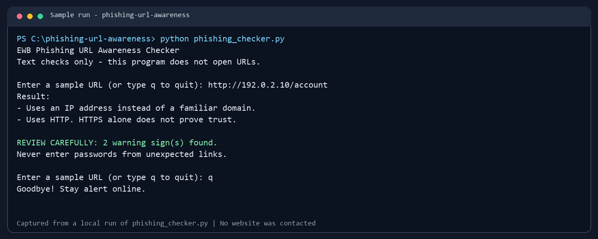
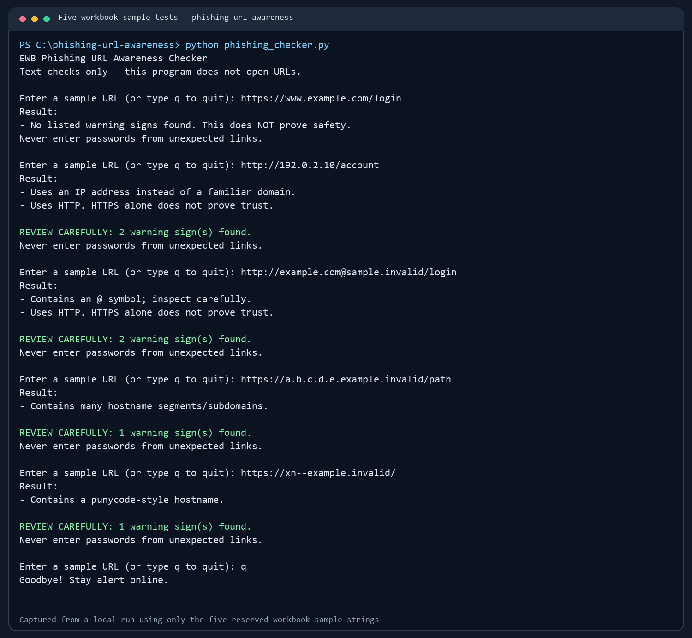

# EWB Phishing URL Awareness Checker

## Overview

Phishing uses deceptive links or messages to trick people into sharing sensitive information. This command-line project checks URL text for a small set of visible warning signs and explains that any result is only a clue.

## Features

- Detects an `@` symbol in the URL
- Flags URLs longer than 100 characters
- Flags IPv4 and IPv6 address hostnames
- Flags hostnames with five or more dot-separated parts
- Flags punycode-style hostnames containing `xn--`
- Flags the HTTP scheme
- Repeats checks until the user enters `q`, `quit`, or `exit`
- Shows a review summary when warning signs are present
- Handles malformed URL text without crashing

## Requirements

Python 3.10 or later. No extra packages are required.

## How to Run

Open a terminal in this folder and run:

```text
Windows:    python phishing_checker.py
Mac/Linux:  python3 phishing_checker.py
```

Enter one of the safe sample strings from `tests/test_samples.md`. Enter `q` to quit.

## Example Output

```text
EWB Phishing URL Awareness Checker
Text checks only - this program does not open URLs.

Enter a sample URL (or type q to quit): http://192.0.2.10/account

Result:
- Uses an IP address instead of a familiar domain.
- Uses HTTP. HTTPS alone does not prove trust.

REVIEW CAREFULLY: 2 warning sign(s) found.
Never enter passwords from unexpected links.
```

## Testing

The five required reserved sample strings and their observed results are recorded in [tests/test_samples.md](tests/test_samples.md). The screenshots below show actual program runs using those sample strings.

To run the automated checks from the project folder, use `python -m unittest discover -s tests` (or `python3` on Mac/Linux).

| # | Input | Expected | Actual | Result |
|---|-------|----------|--------|--------|
| 1 | `https://www.example.com/login` | No warning signs listed | No listed warning signs | PASS |
| 2 | `http://192.0.2.10/account` | IP address + HTTP | IP address + HTTP | PASS |
| 3 | `http://example.com@sample.invalid/login` | `@` + HTTP | `@` + HTTP | PASS |
| 4 | `https://a.b.c.d.e.example.invalid/path` | Many hostname segments | Many hostname segments | PASS |
| 5 | `https://xn--example.invalid/` | Punycode-style hostname | Punycode-style hostname | PASS |

## Screenshots





## Improvements

1. **Repeat and quit:** the program can inspect multiple entries in one run, which makes trying sample cases quicker. I checked that it continues after a URL and exits on `q`.
2. **Review summary:** after actual warning signs, it counts the findings and prints `REVIEW CAREFULLY`. Informational results such as empty input do not trigger that summary.
3. **Safe parsing:** malformed URL text is reported clearly instead of stopping the program. I checked the workbook's malformed IPv6 example.

## Limitations

This is an educational tool. It only reads URL text. It does not visit URLs, scan for malware, check reputation, or prove that a URL is safe. No warning signs found does **not** mean a URL is safe. HTTPS also does not prove that a site is trustworthy.

## Ethical Use

Use the reserved sample strings for practice. Do not collect credentials, send phishing messages, or probe websites or networks. Never upload passwords, API keys, or private information.

## Author

Sayyed Alfiya  
Batch / Course: Add your batch or course name before publishing.

